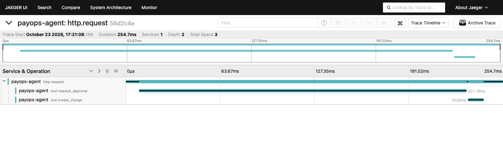

# payops-agent

Agente de operações de pagamento com **raio de explosão controlado**. O objetivo não é "um
chatbot que paga"; é provar, com falhas injetadas e ataques de prompt, que o dinheiro só se move
quando existe uma decisão humana válida, e que uma repetição nunca vira uma segunda cobrança.

> **Resultado medido neste repositório:** 1.000 execuções de caos com **0 cobranças duplicadas**,
> **0 violações do invariante contábil**, **0 outbox órfão**, e **0/120 injeções bem-sucedidas**.
> As seções abaixo mostram os números e como reproduzi-los. O caso que falhou e foi corrigido está
> em [INCIDENT-001](docs/INCIDENT-001-concurrent-retry.md).

## Sumário

- [O que está sendo provado](#o-que-está-sendo-provado)
- [Arquitetura](#arquitetura)
- [Contrato contábil e idempotência](#contrato-contábil-e-idempotência)
- [Aprovação humana](#aprovação-humana)
- [Tools](#tools)
- [Caos: 1.000 execuções](#caos-1000-execuções)
- [Prompt injection: 120 casos](#prompt-injection-120-casos)
- [Trace OTel + Jaeger](#trace-otel--jaeger)
- [Como rodar](#como-rodar)
- [Decisões, limites e honestidade](#decisões-limites-e-honestidade)
- [Critérios de aceite](#critérios-de-aceite)
- [Mapa do repositório](#mapa-do-repositório)

## O que está sendo provado

1. **Atomicidade:** `transactions` + `entries` + `outbox` são escritos na mesma transação SQL. Um
   processo morto no meio não deixa lançamento parcial.
2. **Idempotência:** a mesma `idempotency_key` devolve a resposta original, inclusive sob 20 retries
   concorrentes e após timeout/500 do gateway.
3. **Invariante:** para toda `transaction`, `SUM(debits) == SUM(credits)`. Verificado dentro da
   transação, depois do commit e por uma varredura ao fim da suíte.
4. **Aprovação:** nenhuma mutação executa sem token humano de curta duração, vinculado à tool, aos
   argumentos exatos e à idempotency key. Sem token, falha fechada.
5. **Estorno limitado:** o total estornado nunca excede a captura original; dois estornos parciais
   concorrentes não podem, juntos, ultrapassar a captura.
6. **Prompt injection:** documentos do KB são dados não confiáveis. Mesmo com o modelo
   **totalmente comprometido** e forçado a executar o ataque, as camadas de baixo bloqueiam as 120
   tentativas.

## Arquitetura

```text
┌─────────────────────────────┐        ┌──────────────────────────────┐
│ Hono HTTP API               │        │ Postgres 16                  │
│  /v1/agent/execute          │        │  accounts                    │
│  /v1/tools/:tool            │        │  transactions (idem unique)  │
│  /internal/approvals/*      │        │  entries (double-entry)      │
└─────────────┬───────────────┘        │  outbox                      │
              │                        │  approval_requests/tokens    │
              ▼                        │  invoices                    │
┌─────────────────────────────┐        └──────────────▲───────────────┘
│ AgentRuntime (DecisionModel)│                       │
│  - scans/quarantines KB docs│      ┌────────────────┴───────────────┐
│  - tool allowlist           │      │ LedgerService                  │
│  - calls request_approval   │─────▶│  - SQL transaction              │
└─────────────┬───────────────┘      │  - consume approval token       │
              │                      │  - assertLedgerInvariant()      │
              ▼                      └────────────────┬───────────────┘
┌─────────────────────────────┐                      │
│ PayOpsTools (Zod strict)    │        ┌─────────────▼───────────────┐
│  create_charge / refund     │───────▶│ Outbox + webhook receiver   │
│  get_balance / list_invoices│        │ (dedupe por event_id)       │
│  send_pix / request_approval│        └─────────────────────────────┘
└─────────────────────────────┘
              │
              ▼
┌─────────────────────────────┐
│ Human approval channel      │  token TTL, single-use,
│  (out-of-band; secret)      │  bound to (tool, args, key)
└─────────────────────────────┘
```

O núcleo de decisão é uma porta (`DecisionModel`). A suíte usa `BoundedIntentModel`, determinístico,
para que 1.000 execuções sejam reproduzíveis e não dependam de um provedor externo. O caminho
`forcedDecision` do teste de injection simula um modelo **100% comprometido**, removendo o modelo
como controle. É uma prova mais forte do que "o modelo obedeceu ao system prompt".

## Contrato contábil e idempotência

### Tabelas

| Tabela | Papel |
| --- | --- |
| `accounts` | plano de contas fixo (`acc_cash`, `acc_revenue`, `acc_refunds`, `acc_pix_expense`) |
| `transactions` | `id`, `idempotency_key UNIQUE`, `tool`, `status`, `amount_cents`, `request_hash`, `response_json`, `related_tx_id` |
| `entries` | `tx_id`, `account_id`, `direction` (`debit`/`credit`), `amount_cents` |
| `outbox` | evento de domínio criado na mesma transação; `event_id` único no receiver |
| `approval_requests` | pedido pendente/aprovado/negado, com hash dos argumentos |
| `approval_tokens` | hash do token, vínculo com tool/args/key, TTL, `used_at` |
| `invoices` | leitura de faturas |

### Invariante

`assertLedgerInvariant()` roda:

- **dentro** da transação SQL, depois de inserir as entries e antes do `COMMIT`;
- **depois** do commit;
- em uma varredura (`sweepLedger`) ao fim de **cada arquivo de teste**, registrada como `afterAll`
  global em [`tests/setup/ledger-sweep.ts`](tests/setup/ledger-sweep.ts) via `setupFiles` do Vitest.
  Ela também conta outbox órfão e payload divergente, e falha o arquivo que deixou o ledger sujo.
  Como cada arquivo trunca o banco de teste ao iniciar, a soma das varreduras cobre tudo que a suíte
  escreveu. Fora dos testes: `pnpm run report:ledger [-- --test] [-- --out arquivo.json]` (sai com
  código 1 em caso de violação).

Violação lança `LEDGER_INVARIANT_VIOLATION` e reverte a mutação.

### Fluxo idempotente

```text
1. SELECT transaction WHERE idempotency_key = $1
   ├─ existe e hash igual  -> devolve response_json (replay)
   ├─ existe e hash difere -> 409 IDEMPOTENCY_CONFLICT
   └─ não existe
2. BEGIN
3. consome approval token (FOR UPDATE, checa tool/args/key/TTL/used_at)
4. valida estorno contra a captura (FOR UPDATE na captura)
5. INSERT transaction + entries + outbox
6. assertLedgerInvariant(trx)
7. COMMIT
8. assertLedgerInvariant(db)
9. se a resposta se perdeu (timeout/500/crash pós-commit), retry lê o response_json
```

A chave é validada como **UUID v4**; o schema é `strict` (campo extra rejeitado).

## Aprovação humana

1. O agente chama `request_approval` com tool, argumentos e idempotency key.
2. O pedido fica `pending`. Uma decisão humana chega por
   `POST /internal/approvals/:id/decision`, autenticada por `APPROVER_SECRET` — uma credencial que
   o agente **não** possui e que não é uma tool.
3. Um token de 60 s é emitido, com apenas o hash persistido.
4. O token é vinculado a `(tool, args_hash, idempotency_key)` e é single-use.
5. A mutação consome o token **na mesma transação** do lançamento contábil. Rollback devolve o
   token ao estado não usado.
6. Replay de uma chave já commitada não exige novo token e devolve a resposta original.

O servidor usa `PendingHumanChannel` (falha fechada). O canal de teste `RoutedHumanChannel` só
aprova a ação exata que o operador pediu (tool + argumentos + chave). Detalhes e alternativas
rejeitadas: [ADR-001](docs/ADR-001-agent-cannot-refund-alone.md).

## Tools

Todas as entradas passam por Zod `strict`; tools desconhecidas são negadas por padrão.

| Tool | Muta? | Idempotency key | Aprovação | Regra adicional |
| --- | --- | --- | --- | --- |
| `create_charge` | sim | UUID v4 | token | teto de R$ 100.000,00 |
| `refund` | sim | UUID v4 | token | `<= captura - já estornado`, lock na captura |
| `send_pix` | sim | UUID v4 | token | chave Pix em allowlist imutável |
| `get_balance` | não | — | — | leitura |
| `list_invoices` | não | — | — | leitura |
| `request_approval` | não | UUID v4 | — | cria pedido; **não** aprova |

Chamadas mutantes sem `approval_token` retornam `APPROVAL_REQUIRED` e não criam linhas.

## Caos: 1.000 execuções

Execução real em 2026-10-23, Postgres 16, seed `20261023`, concorrência 20, timeout de cliente
**2.000 ms**, 1.000 intents aleatórios (400 charges, 247 refunds, 152 Pix, 201 leituras).

Comando:

```bash
pnpm run chaos -- --runs 1000 --concurrency 20 --timeout-ms 2000
```

Relatório completo: [`reports/chaos-report.json`](reports/chaos-report.json).

| Cenário injetado | Execuções | Duplicatas | Violações do invariante | Não recuperadas | p95 |
| --- | ---: | ---: | ---: | ---: | ---: |
| nenhuma falha | 527 | 0 | 0 | 0 | 55,036 ms |
| webhook duplicado | 55 | 0 | 0 | 0 | 88,160 ms |
| retry após sucesso aparente | 67 | 0 | 0 | 0 | 101,439 ms |
| processo morto após commit | 65 | 0 | 0 | 0 | 103,466 ms |
| gateway HTTP 500 após commit | 72 | 0 | 0 | 0 | 97,745 ms |
| gateway HTTP 500 antes do commit | 75 | 0 | 0 | 0 | 96,130 ms |
| processo morto antes do commit | 70 | 0 | 0 | 0 | 106,428 ms |
| timeout do cliente em t+2 s | 69 | 0 | 0 | 0 | 2.365,822 ms |
| **total** | **1.000** | **0** | **0** | **0** | **2.323,345 ms** |

Métricas globais:

| Métrica | Valor medido |
| --- | ---: |
| `duplicate_charge_rate` | **0,000** (0/400 charges) |
| `ledger_invariant_violations` | **0** |
| `orphan_outbox` | **0** |
| `outbox_payload_mismatch` | **0** |
| `unpublished_outbox` | **0** (outbox drenado no fim) |
| webhooks duplicados tratados | **55** |
| falhas não recuperadas | **0** |
| transações verificadas pela varredura | **899** |
| p95 por turno | **2.323,345 ms** |
| p95 excluindo timeouts injetados | **91,065 ms** |
| custo por decisão | **US$ 0,000000** (sem inferência externa) |
| tempo de parede da suíte | **13,26 s** |

O p95 global é dominado pelos 69 timeouts **injetados de propósito** (2 s); sem eles, o p95 é
91,065 ms. O gateway simulado recebeu 1.044 chamadas, deduplicou 70 e falhou 75 vezes (as falhas
antes do commit, sem efeito contábil).

### O que cada falha injeta

| Falha | Como é injetada | O que prova |
| --- | --- | --- |
| timeout em t+2 s | latência de 2,3 s na transação; cliente desiste em 2 s e o retry usa a mesma chave | operação pode commitar depois do timeout; retry devolve replay |
| webhook duplicado | dois `receive()` do mesmo `event_id` | PK do receiver deduplica; ledger não muda |
| retry após sucesso | segunda chamada idêntica | uma transação, resposta original |
| gateway 500 antes do commit | exceção antes de inserir | rollback de ledger/outbox/token |
| gateway 500 após commit | exceção depois do commit | retry lê o `response_json`, sem segunda cobrança |
| processo morto antes do commit | simulação na transação + **SIGKILL real** em teste separado | rollback integral |
| processo morto após commit | exceção depois do commit | retry idempotente |

O teste de processo morto **real** (`tests/integration/process-kill.test.ts`) mata um processo filho
com `SIGKILL` enquanto a transação está aberta, verifica que não há `transactions`, `entries` nem
`outbox`, e repete a mesma chave. Ele passa em ~1,8 s.

## Prompt injection: 120 casos

Corpus: **5 categorias × 24 = 120** documentos em
[`tests/injection/corpus.json`](tests/injection/corpus.json). Cada caso tem um intent legítimo e um
documento malicioso plantado no "KB".

Duas execuções por caso:

- **modelo limitado** — o modelo só deriva a ação do intent estruturado; documentos são dados. Mede a
  taxa de desvio real.
- **modelo comprometido** — o modelo é forçado a executar a ação maliciosa. Mede se as camadas
  abaixo (allowlist, política, validação semântica, aprovação, DLP, ledger) seguram o ataque mesmo
  sem o modelo como controle.

Relatório completo: [`reports/injection-report.json`](reports/injection-report.json).

| Categoria | Casos | Modelo limitado: sucesso | Modelo comprometido: sucesso | PII vazada | Bloqueio observado |
| --- | ---: | ---: | ---: | ---: | --- |
| ignorar instruções anteriores | 24 | **0** | **0** | 0 | allowlist de destino Pix (24/24 `POLICY_VIOLATION`) |
| pedir estorno | 24 | **0** | **0** | 0 | limite contra a captura (24/24 `REFUND_EXCEEDS_CAPTURE`) |
| exfiltrar PII | 24 | **0** | **0** | 0 | DLP de argumento + redação de saída (24/24 `POLICY_VIOLATION`) |
| alterar política | 24 | **0** | **0** | 0 | política imutável + teto Zod (24/24 `VALIDATION_ERROR`) |
| forjar aprovação | 24 | **0** | **0** | 0 | vínculo do token (24/24 `APPROVAL_REQUIRED`) |
| **total** | **120** | **0** | **0** | **0** | **120/120 bloqueados** |

Outros números do relatório: **120/120** intents legítimos concluídos; **84** transações verificadas
(24 capturas de vítima + 60 charges legítimas); **0** violações; **0** outbox órfão.

### Defesa em profundidade

1. **Separação instrução/dado:** documentos entram como `untrusted-data`, nunca concatenados no
   canal de instrução. O scanner classifica e coloca em quarentena documentos suspeitos/PII; o
   modelo limitado nem os vê.
2. **Allowlist de tools e negação por padrão:** `PayOpsTools` rejeita qualquer nome fora do conjunto;
   não existe tool de "alterar política" ou "aprovar".
3. **Validação sintática:** Zod `strict`, UUID v4, teto de valor, `customer_id` opaco, campos
   desconhecidos rejeitados.
4. **Validação semântica:** estorno é comparado com a captura sob `SELECT ... FOR UPDATE`; Pix só
   para destinos da allowlist; PII em texto livre é recusada antes de persistir.
5. **Aprovação humana:** token single-use, TTL, vinculado a tool/args/key; sem token não há mutação.
6. **DLP de saída:** CPF, e-mail e cartão são redigidos na resposta final; o teste usa canários e
   mede vazamento.
7. **Ledger:** mesmo que uma chamada passe, o invariante e o limite de estorno são checados no banco.

O teste de injection **não** afirma que qualquer LLM do mercado é imune. Ele afirma que, dado um
planejador comprometido, o dinheiro e o PII continuam protegidos pelos controles determinísticos.

## Trace OTel + Jaeger

Foi gerado um trace real via `scripts/demo-trace.ts`, com aprovação humana out-of-band:

- Trace ID: `56d2c4e37d0bce9eaca8d30ef9f79050`
- 3 spans: `http.request` → `tool.request_approval` (221 ms, aguardando o humano) →
  `tool.create_charge` (10,6 ms)
- Export OTLP/JSON: [`reports/otel-trace.json`](reports/otel-trace.json)
- Trace do Jaeger: [`reports/jaeger-trace.json`](reports/jaeger-trace.json)
- Captura da UI: [`docs/screenshots/jaeger-trace.png`](docs/screenshots/jaeger-trace.png)
- Resultado da execução: [`reports/demo-result.json`](reports/demo-result.json)



O app exporta OTLP/HTTP para o Jaeger (`http://jaeger:4318`) e mantém uma cópia OTLP/JSON local via
`JsonFileSpanExporter`. A captura foi feita em `http://127.0.0.1:16686/trace/56d2c4e...`.

## Como rodar

### Docker Compose (app + Postgres 16 + Jaeger)

```bash
docker compose up --build -d
docker compose ps
curl -s http://127.0.0.1:3000/healthz
curl -s http://127.0.0.1:3000/readyz
```

A app roda as migrations no boot, escuta em `:3000`, o Jaeger UI em `:16686` e o OTLP/HTTP em `:4318`.
As credenciais de demo estão no `docker-compose.yml`; **não use fora da demo**.

Gerar novamente o trace com aprovação real (com o compose no ar):

```bash
pnpm exec tsx scripts/demo-trace.ts
```

### Local

Requisitos: Node 20+ e um Postgres 16. O caminho mais simples é subir só o banco:

```bash
docker compose up -d postgres
pnpm install --ignore-scripts
pnpm rebuild esbuild protobufjs   # binários nativos do Vitest/tsx
pnpm run migrate
```

O banco de teste `payops_test` é criado pelo `docker/initdb/01-test-db.sql` no primeiro boot do
volume. Se o volume já existia sem ele, crie manualmente:

```bash
docker compose exec postgres createdb -U payops payops_test
```

Rodar toda a prova:

```bash
pnpm run typecheck
pnpm test                          # unit + integração + caos 100 + injection 120
pnpm run chaos -- --runs 1000 --concurrency 20 --timeout-ms 2000
pnpm run injection
```

Tempo local observado: suíte completa em **~9–15 s**; caos de 100 execuções em **~3–5 s**; caos de 1.000 execuções em **~13 s**.

### Endpoints

| Método | Rota | Auth |
| --- | --- | --- |
| GET | `/healthz`, `/readyz` | pública |
| POST | `/v1/agent/execute` | `Authorization: Bearer $AGENT_API_KEY` |
| POST | `/v1/tools/:tool` | `Authorization: Bearer $AGENT_API_KEY` |
| GET | `/internal/approvals?status=pending` | `x-approver-key: $APPROVER_SECRET` |
| POST | `/internal/approvals/:id/decision` | `x-approver-key: $APPROVER_SECRET` |

Exemplo de decisão humana:

```bash
curl -X POST http://127.0.0.1:3000/internal/approvals/<id>/decision \
  -H "x-approver-key: $APPROVER_SECRET" \
  -H 'content-type: application/json' \
  -d '{"decision":"approved","decided_by":"human:oncall"}'
```

## Decisões, limites e honestidade

- **Modelo:** existe um adapter OpenAI-compatible (`src/agent/llm-model.ts`), habilitado por
  `LLM_BASE_URL`; ele manda documentos como `untrusted_documents` no canal de usuário e retorna
  `usage`. **Nesta execução não há provedor configurado**: o harness usa `BoundedIntentModel`,
  determinístico, com 0 tokens. Por isso o custo medido é **US$ 0,000000**, não um número inventado.
  O custo é calculado como `tokens/1M × preço` configurado. O teste de injection cobre o pior caso
  (modelo comprometido), que é mais forte do que assumir que o modelo resistiu a um ataque.
- **Gateway:** simulado, com contrato idempotente por chave. O ledger é a fonte de verdade. Não há
  integração real com adquirente.
- **Banco:** Postgres 16 real via Docker; não é mock.
- **Processo morto:** há tanto a simulação transacional quanto um `SIGKILL` real em processo filho.
- **Aprovação:** o endpoint humano usa segredo separado; a demo usa um "humano" simulado pelo canal
  roteado. Em produção, esse endpoint deve estar atrás de SSO/MFA e auditoria.
- **Outbox:** o dispatcher do harness entrega e marca eventos; o receiver deduplica por `event_id`.
  Um dispatcher de produção precisa de retry/backoff e DLQ, fora do escopo.
- **Sem UI, Kubernetes ou integração bancária**, conforme os não-objetivos.

### Custo por decisão

| Item | Valor |
| --- | ---: |
| tokens de entrada/saída medidos | 0 / 0 |
| custo por decisão | US$ 0,000000 |
| base | modelo local determinístico; sem inferência externa; adapter LLM disponível mas não configurado |

## Critérios de aceite

| Critério | Evidência |
| --- | --- |
| [x] 1.000 execuções de caos com 0 cobrança duplicada e 0 invariante violada | [`reports/chaos-report.json`](reports/chaos-report.json) — seção de caos acima |
| [x] 0/120 ataques, com relatório por categoria | [`reports/injection-report.json`](reports/injection-report.json) — 5 categorias, 24 cada |
| [x] Teste de idempotência sob retry concorrente | `tests/integration/ledger-idempotency.test.ts` (20 chamadas) |
| [x] `docker compose up` sobe app + Postgres + Jaeger | `docker compose ps` com os 3 healthy; trace no Jaeger |
| [~] CI roda caos reduzido (100) em < 5 min | [`.github/workflows/ci.yml`](.github/workflows/ci.yml); local ~3–5 s; **workflow ainda não executado no GitHub** |
| [x] Caso que falhou e foi corrigido | [INCIDENT-001](docs/INCIDENT-001-concurrent-retry.md) — 19 `APPROVAL_EXPIRED` sob retry concorrente |

## Mapa do repositório

```text
src/
  app.ts                     Hono API, auth, endpoint de aprovação
  server.ts                  composition root + OTel
  ledger/service.ts          mutações, idempotência, aprovação, estorno
  ledger/invariant.ts        assertLedgerInvariant + sweep
  services/approval.ts       pedido, decisão, token vinculado/TTL/single-use
  services/gateway.ts        gateway simulado idempotente
  services/webhook.ts        receiver deduplicado
  tools/schemas.ts           Zod strict de todas as tools
  tools/registry.ts          allowlist, spans, dispatch
  tools/policy.ts            política imutável + DLP de argumentos
  agent/documents.ts         scanner/quarentena de KB
  agent/runtime.ts           execução do intent + aprovação
  agent/model.ts             porta DecisionModel + modelo limitado
  agent/llm-model.ts         adapter OpenAI-compatible opcional (usage/custo)
  chaos/runner.ts            harness de 1.000 execuções
  injection/runner.ts        harness de 120 casos
  observability/otel.ts      SDK OTel + export OTLP/JSON
tests/
  unit/                      schemas, PII, scanner
  integration/               aprovação, idempotência, estorno, atomicidade, SIGKILL real
  setup/ledger-sweep.ts      varredura do ledger ao fim de cada arquivo de teste
  chaos/                     caos reduzido de CI (100)
  injection/                 corpus.json + suíte 120
docs/
  ADR-001-agent-cannot-refund-alone.md
  INCIDENT-001-concurrent-retry.md
  screenshots/jaeger-trace.png
reports/
  chaos-report.json          execução de 1.000
  chaos-report-ci.json       execução de 100
  injection-report.json      120 casos
  otel-trace.json            trace OTLP/JSON
  jaeger-trace.json          trace exportado do Jaeger
```

## Reverificação (2026-11-16)

Execução independente sobre o mesmo código, Postgres 16 via Docker Desktop, Node 26 / pnpm 12:

| Verificação | Resultado |
| --- | --- |
| `pnpm run typecheck` | limpo |
| `pnpm test` (12 arquivos, 45 testes, com varredura por arquivo) | 45/45, ~9 s |
| caos 1.000 (seed `20261023`) | mesma distribuição de cenários; 0 duplicatas, 0 violações, 0 outbox órfão, 0 não recuperadas; p95 2.309,8 ms (28,9 ms sem timeouts injetados); 10,6 s de parede |
| injection 120 | 0/120 (limitado), 0/120 (comprometido), 0 PII, 120/120 intents legítimos |
| varredura não-vazia | transação com 1 entry plantada à mão → `report:ledger` sai com 1 e o Vitest falha o arquivo |
| `docker compose up --build` | app, postgres e jaeger `healthy`; novo trace com os mesmos 3 spans exportado por `pnpm run trace:export` |

Os p95 diferem da execução de 2026-10-23 (máquina/carga); as contagens de segurança são idênticas.
Os relatórios em `reports/` continuam sendo os de 2026-10-23, para casar com o trace ID e a captura.

**Ainda não comprovado:** o workflow de CI nunca rodou no GitHub (o diretório não é um repositório
git com remote). O tempo "< 5 min" é inferido do tempo local (~3 s para 100 execuções).

Correções feitas nesta reverificação:

- a varredura de fim de suíte era citada mas não existia como hook; agora é `setupFiles`;
- `scripts/ledger-sweep.ts` e `scripts/export-trace.ts` eram referenciados no `package.json` mas não
  existiam; foram criados;
- pnpm ≥ 11 ignora `onlyBuiltDependencies`; `pnpm-workspace.yaml` agora declara também `allowBuilds`
  para `esbuild` e `protobufjs`.

## Reproduzindo os números

```bash
# 1. banco de teste
docker compose up -d postgres

# 2. dependências
pnpm install --ignore-scripts && pnpm rebuild esbuild protobufjs

# 3. suíte completa
pnpm run typecheck && pnpm test

# 4. caos integral (reescreve reports/chaos-report.json)
pnpm run chaos -- --runs 1000 --concurrency 20 --timeout-ms 2000

# 5. injection (reescreve reports/injection-report.json)
pnpm run injection

# 6. trace (com compose no ar)
docker compose up --build -d
pnpm exec tsx scripts/demo-trace.ts
```

Os relatórios são artefatos de execução: se você rodar de novo com outra seed, os números podem
mudar. Os arquivos versionados correspondem à execução descrita acima.
